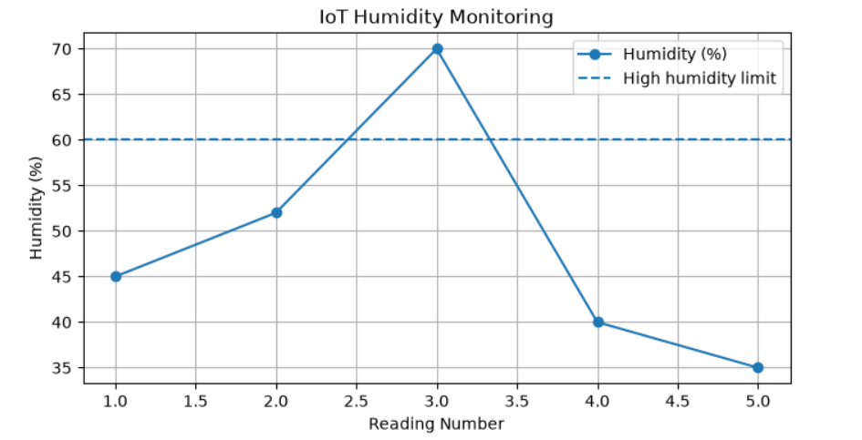

# IoT Sensor Data Analyzer
A beginner-friendly Python project that analyzes IoT temperature and humidity sensor readings using data analysis, alert detection, and graphical visualization.
## Project Overview
The IoT Sensor Data Analyzer processes temperature and humidity readings, identifies abnormal environmental conditions, calculates average values, and displays sensor data using graphs.
This project demonstrates how Python can be used to analyze sensor data in an Internet of Things (IoT) application.
##Features
- Analyzes temperature readings
- Analyzes humidity readings
- Detects high and low temperature conditions
- Detects high humidity levels
- Calculates average temperature and humidity
- Visualizes sensor readings using graphs
- Generates a sensor status report
- Stores sensor readings in a CSV file
## Technologies Used
- Python
- Jupyter Notebook
- Matplotlib
- CSV data handling
- GitHub
## Project Structure
```text
IoT_Sensor_Data_Analyzer/
│
├── IoT_Sensor_Data_Analyzer.ipynb
├── iot_sensor_readings.csv
├── humidity_graph.png
└── README.md
```
## Sample Sensor Data
The project uses sample temperature and humidity readings to demonstrate sensor data analysis.
| Reading | Temperature (°C) | Humidity (%) |
|---|---:|---:|
| 1 | 25.5 | 45 |
| 2 | 28.0 | 52 |
| 3 | 35.0 | 70 |
| 4 | 24.0 | 40 |
| 5 | 19.0 | 35 |
*Note: These are sample readings used for demonstration, not live sensor measurements.*
## Graphical Output
### IoT Humidity Monitoring
The graph displays humidity readings and the high-humidity reference limit.

## How It Works
1. Collects sample temperature and humidity readings.
2. Processes the readings using Python.
3. Calculates average temperature and humidity.
4. Checks readings against predefined threshold values.
5. Generates a sensor status report.
6. Displays graphical representations of humidity data.
## How to Run the Project
1. Download or clone this repository.
2. Open `IoT_Sensor_Data_Analyzer.ipynb` in Jupyter Notebook.
3. Make sure the required Python libraries are installed.
4. Run the notebook cells in order.
5. Observe the analysis results, alerts, and graphs.
Install Matplotlib if required:
```bash
pip install matplotlib
```
## Learning Outcomes
- Understanding IoT sensor data
- Working with Python dictionaries and lists
- Using loops and conditional statements
- Performing basic data analysis
- Creating graphs using Matplotlib
- Organizing and documenting a project on GitHub
## Future Improvements
- Connect real temperature and humidity sensors
- Integrate ESP32 or Arduino for live data collection
- Display real-time sensor readings
- Add a live monitoring dashboard
- Store sensor data in a database
- Send notifications when readings exceed safe limits
## Author
**Yashaswini KM**
B.E. Computer Science and Engineering (IoT)
GitHub: [@yashaswiniyashu616-ux](https://github.com/yashaswiniyashu616-ux)
LinkedIn: [Yashaswini KM](https://www.linkedin.com/in/yashaswini-km-83ba60386)
---
⭐ If you find this project interesting, consider giving the repository a star!
**Built with Python and curiosity about IoT.**
86)
---
⭐ If you find this project interesting, consider giving the repository a star!
#IoT #Python #DataAnalysis #JupyterNotebook #GitHub #EngineeringStudent
  
